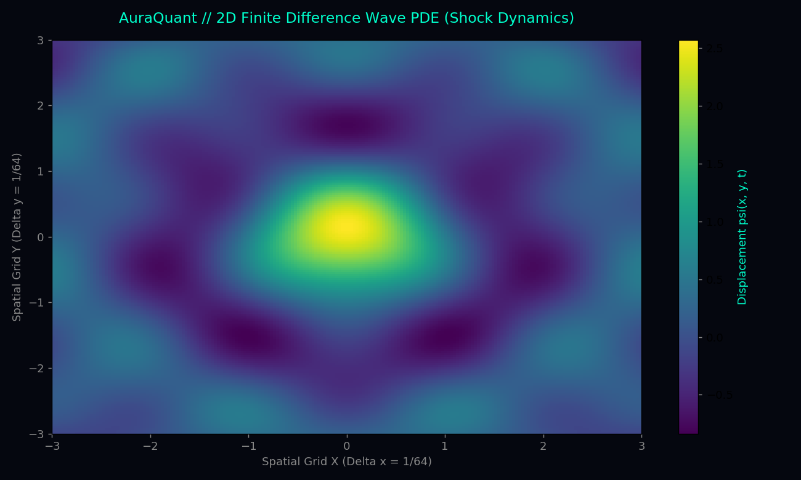
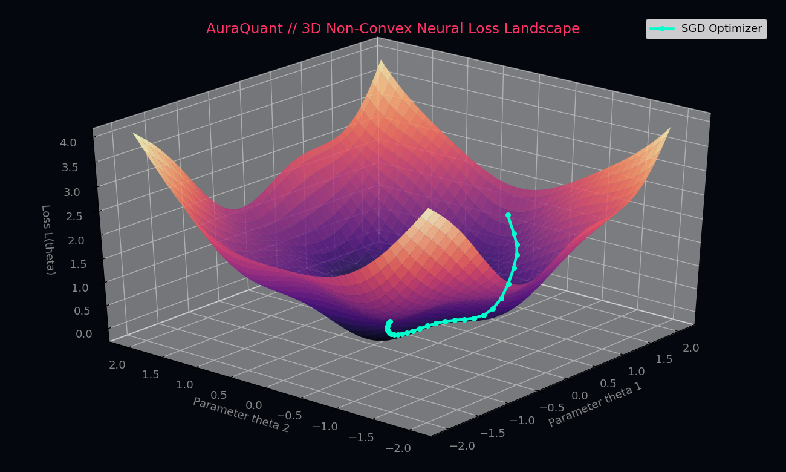
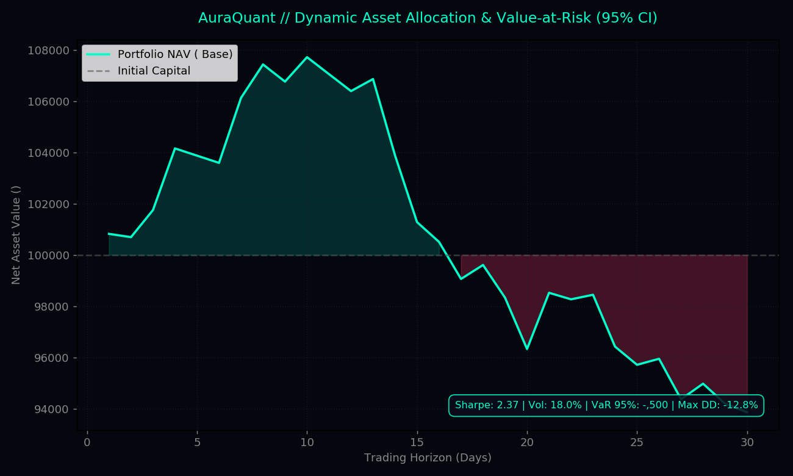
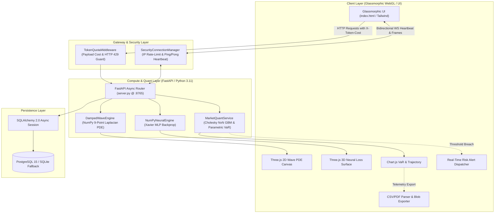

<div align="center">

# ⚡ AURAQUANT // Q-CORE
### High-Performance Quantum-Neural Financial Simulation, PDE Wave Dynamics & Parametric Risk Engine

[](https://fastapi.tiangolo.com)
[](https://python.org)
[](https://numpy.org)
[](https://threejs.org)
[](https://www.postgresql.org)
[](LICENSE)

*A production-grade, full-stack quantitative research testbed combining non-convex optimization topology, 2D continuous wave field mechanics, parametric VaR stress-testing, and real-time telemetry streaming.*

---

</div>

## 📌 Table of Contents
1. [Overview & Purpose](#-overview--purpose)
2. [Visual Walkthrough & Telemetry Viewports](#-visual-walkthrough--telemetry-viewports)
3. [System Architecture](#-system-architecture)
4. [Core Features Breakdown](#-core-features-breakdown)
5. [Directory Structure](#-directory-structure)
6. [Data Ingestion & Portfolio Specifications](#-data-ingestion--portfolio-specifications)
7. [Quick Start & Deployment](#-quick-start--deployment)
8. [Legal & Compliance Notice](#-legal--compliance-notice)

---

## 🎯 Overview & Purpose

**AuraQuant // Q-CORE** bridges modern quantitative finance with physics-informed computational mechanics and deep learning optimization. It delivers an interactive, real-time command dashboard designed for:

- **Continuous PDE Wave Shock Propagation:** Modeling liquidity contagion across multi-asset order books using 2D finite difference hyperbolic wave equations (∂²ψ/∂t² = c²∇²ψ).
- **Non-Convex Neural Loss Landscapes:** Visualizing 3D gradient descent trajectories over non-convex objective topologies in real time.
- **Parametric Portfolio Risk & Stress-Testing:** Simulating multi-asset geometric Brownian motion with Cholesky-correlated return matrices, calculating parametric Value-at-Risk (95% CI), annualized volatility, and maximum peak-to-trough drawdowns.
- **Defensive API Gatekeeping:** Enforcing token-bucket quota middleware and WebSocket heartbeat protocols to ensure resilient client-server synchronization under high concurrency.

---

## 📸 Visual Walkthrough & Telemetry Viewports

### 1. 2D Finite Difference Wave PDE (Liquidity Shock Field)

*Real-time spatial propagation of liquidity shocks across a $64 \times 64$ discrete mesh. The engine solves the 2D wave equation with 9-point Laplacian stencils, absorbing boundary conditions, and Bessel harmonic excitations. Color gradients map local asset stress amplitude $\psi(x, y, t)$.*

---

### 2. 3D Non-Convex Neural Loss Landscape

*Interactive 3D WebGL surface rendering a non-convex cross-entropy objective function $L(\theta)$. Displays live gradient descent optimization paths (Stochastic Gradient Descent with momentum and learning rate scheduling), mapping parameter migration through local saddle points and global minima.*

---

### 3. Dynamic Asset Allocation & Value-at-Risk Dynamics

*Real-time multi-asset portfolio simulation driven by an $N \times N$ Cholesky covariance decomposition matrix. Supports on-the-fly portfolio reweighting across equities, fixed-income instruments, and digital assets, with instantaneous 95% Parametric VaR updates and historical loss distributions.*

---

## 🏗 System Architecture



---

## ⚡ Core Features Breakdown

### 1. Backend Security & Storage Tier
- **TokenQuotaMiddleware:** Inspects client-provided `X-Token-Cost` headers per request frame. Rejects abusive workloads exceeding 500 tokens with clean `HTTP 429 Too Many Requests` responses, appending `X-Token-Quota-Consumed` auditing headers.
- **Dual-Engine Async Persistence:** SQLAlchemy 2.0 async engine dynamically binds to PostgreSQL (`asyncpg`) in containerized environments and gracefully degrades to local `aiosqlite` for zero-setup offline development.
- **Connection Security Manager:** Limits concurrent WebSocket connections per IP address (max 3) and runs periodic non-blocking ping-pong heartbeat challenges to eliminate zombie sockets.

### 2. Quantitative & Physics Solvers
- **Cholesky Correlation Engine:** Evaluates $N \times N$ covariance matrices and applies Cholesky factorization ($L \cdot L^T = \Sigma$) to simulate correlated Brownian motion drift across user-defined asset portfolios.
- **Finite Difference Wave Solver:** High-frequency 2D grid simulation supporting multi-point harmonic excitations, spatial damping, and dynamic boundary reflection absorbing layers.
- **Xavier Neural Optimizer:** Multi-layer perceptron topology tracking real-time weight adjustments, loss trajectories, and convergence metrics.

### 3. Glassmorphic User Experience
- **Cyber-Quantum Visual Design:** Tailored with Tailwind CSS, dark glassmorphic panels, dynamic backdrop blurs, scanline CRT overlays, and neon status gauges.
- **Audible Telemetry Feedback:** Synthesized Web Audio API sound effects for button interactions, parameter modifications, and critical liquidity shock alerts.
- **Zero-Dependency Exporters:** Native browser Blob generation to export full portfolio weights, risk statistics, and neural loss histories to `.csv`, paired with `@media print` CSS rules for instant executive PDF reports.

---

## 📂 Directory Structure

```text
cyber-quantum-dashboard/
├── assets/
│   ├── neural_landscape_preview.png   # 3D Neural loss surface visualization
│   ├── portfolio_risk_preview.png     # Asset allocation & VaR trajectory
│   └── wave_pde_preview.png           # 2D Wave PDE displacement field
├── .dockerignore                      # Production container exclusion list
├── .gitignore                         # Local database & environment exclusion
├── Dockerfile                         # Multi-stage production Docker build
├── docker-compose.yml                 # Orchestration with PostgreSQL 15 & healthchecks
├── README.md                          # Flagship engineering documentation
├── requirements.txt                   # Pinned backend dependencies
├── server.py                          # FastAPI application & WebSocket handlers
├── middleware.py                      # TokenQuotaMiddleware & SecurityConnectionManager
├── database.py                        # Async database engine & session dependency
├── models.py                          # SQLAlchemy ORM entity models
├── market_service.py                  # Correlated GBM market simulation service
├── simulation_engine.py               # Wave PDE & Neural mathematical solvers
├── index.html                         # Unified glassmorphic frontend & UI templates
└── app.js                             # Client-side WebGL, Chart.js & Alert controller
```

---

## 📊 Data Ingestion & Portfolio Specifications

AuraQuant // Q-CORE supports on-the-fly portfolio weight parsing directly through the frontend dashboard:

### 1. CSV Format Specification
Import custom asset distributions using comma-separated files:
```csv
ticker,weight
NVDA,25.0
AAPL,15.0
MSFT,15.0
BTC-USD,10.0
ETH-USD,10.0
AMZN,10.0
GOOGL,5.0
TSLA,5.0
SPY,2.5
GLD,2.5
```

### 2. PDF Text Format Specification
The built-in parser extracts tabular lines matching standard allocation syntax (e.g. `NVDA: 25%` or `BTC-USD 10.0%`).

---

## 🚀 Quick Start & Deployment

### Option A: Local Python Environment

```bash
# 1. Clone repository
git clone https://github.com/saviochackoxavier-tech/auraquant-qcore.git
cd auraquant-qcore

# 2. Install dependencies
pip install -r requirements.txt

# 3. Launch application server
python server.py
# Server binds to http://127.0.0.1:8765

# 4. Open dashboard
# Navigate to index.html in any modern WebGL-compatible browser
```

### Option B: Docker Multi-Stage Container

```bash
# Build and run standalone container
docker build -t auraquant-qcore:latest .
docker run -d -p 8765:8765 --name auraquant auraquant-qcore:latest
```

### Option C: Docker Compose (Production Stack with PostgreSQL)

```bash
# Launch FastAPI backend + PostgreSQL 15 alpine database
docker compose up -d

# Verify system health
docker compose ps
curl http://127.0.0.1:8765/api/records/summary
```

---

## ⚖️ Legal & Compliance Notice

> [!WARNING]
> **FINANCIAL SIMULATION DISCLAIMER:** AuraQuant // Q-CORE is an experimental scientific and educational research application. All asset trajectories, stochastic processes, and risk indicators generated by this platform are simulated using mathematical approximations (Geometric Brownian Motion, finite difference PDE stencils, and synthetic volatility models). Nothing in this repository constitutes investment, financial, tax, or legal advice.

> [!NOTE]
> **DATA PROVIDER ATTRIBUTION:** Fallback asset data points use Yahoo Finance (`yfinance`) public quotation hooks for non-commercial research purposes. Market volatility and covariance estimations do not guarantee future live execution performance.

---

<div align="center">
  <sub>Engineered by Savio Chacko Xavier & Antigravity Agentic Systems • Released under the MIT License</sub>
</div>
